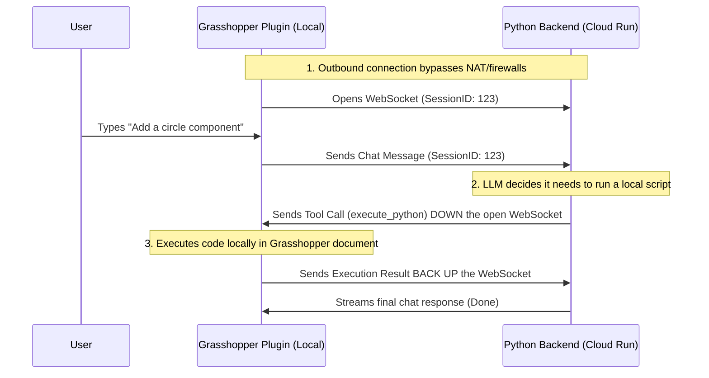

# nextra.gh Architecture

The `nextra.gh` system is designed as a decoupled architecture consisting of three main components: a web-based frontend, a C# Grasshopper Plugin host, and a Python AI Backend. 

This architecture enables a rich, web-native user experience inside Grasshopper while delegating heavy AI and LLM workloads to a scalable backend (either locally or in the cloud).

---

## 1. The Frontend (Web UI)
**Location:** `/frontend/`

The user interface is entirely built using web technologies (HTML, CSS, JavaScript). By using standard web technology instead of native Windows Forms/WPF:
- The UI can easily be iterated on.
- Rich interactivity, styling, and animations are easier to achieve.
- The same frontend codebase can be shared across different host applications (like Rhino and Grasshopper).

## 2. The Grasshopper Plugin (C#)
**Location:** `/GrasshopperPlugin/`

The Grasshopper plugin acts as the bridge between the Grasshopper document, the user's screen, and the AI backend.

### Key Components:
- **`LocalUIServer.cs`**: When Grasshopper loads the plugin, this spins up a lightweight embedded HTTP server starting at `127.0.0.1:58000`. If port `58000` is taken by another Grasshopper instance, it automatically increments (e.g., `58001`, `58002`). It serves the static UI files from the `frontend/` directory, avoiding browser restrictions with `file:///` paths.
- **`NextraMainWindow.cs`**: Embeds a Chromium-based `WebView` that navigates to the `LocalUIServer` to render the UI.
- **`WorkerClient.cs` / `PluginWebSocketService.cs`**: Manages the bi-directional communication between the Grasshopper plugin and the Python AI Backend.

## 3. The Python AI Backend
**Location:** `/backend/`

The backend handles the heavy lifting: communicating with the LLM (Gemini), maintaining session state, and deciding what actions to take in the Grasshopper document.

### Local vs Cloud Ports Explained
The backend uses different ports depending on *where* it is deployed.

* **In the Cloud (Google Cloud Run):** 
  Cloud platforms automatically inject a `PORT` environment variable (usually `8080`). The `agent.py` script detects this and runs on that port. The cloud does **not** use port `58001`.
* **Local Development (Your PC):**
  When you run the backend locally on your machine, the `PORT` variable is missing. The script safely falls back to a default port (e.g., `58001`) so you can test locally without conflicts.

---

## The "Reverse" WebSocket Architecture

A common question is: *If the backend is in the Cloud, how does it know which `localhost` IP or port to send execution commands to? How does it bypass my firewall?*

The answer is that the **Cloud backend never initiates a connection to your local machine.** Instead, the connection happens in reverse using **Outbound WebSockets**.

### How it handles multiple instances without port conflicts:
1. When you open Grasshopper, the plugin generates a unique `SessionId` (e.g., `Session_123`).
2. The plugin makes an **outbound** connection *up* to the Cloud Backend. Because it originates from your computer, it completely bypasses your router/firewall.
3. If you open a second instance of Grasshopper, it generates `Session_456` and opens a *second* WebSocket connection.
4. When the Cloud AI decides it needs to execute code locally, it simply sends the command **down the already-open socket** associated with that specific `SessionId`.

### Communication Flow Visualization

---

## 🤖 AI Assistant Guidelines
*Note for AI Coding Assistants working on this project:*
1. **Always save your artifacts**: Whenever you generate a `walkthrough.md`, `implementation_plan.md`, `task.md`, or any significant documentation detailing the work you've done, you MUST save a copy of those markdown files into the project's `logs/` directory.
2. **Timestamped Folders**: Create a subfolder inside `logs/` named with the current date and time (format: `YYYY-MM-DD_HH-MM-SS`) and place the markdown files there. This ensures a persistent, historical record of all architectural decisions and fixes.
