# Guía Operativa de Uso: Servidor FastMCP LinkedIn (v1.1.0) de Jesús Moronta

Esta guía establece el manual operativo, la arquitectura de ingeniería y los casos de uso prácticos para las **32 herramientas** integradas en el servidor FastMCP [`linkedin_server.py`](file:///c:/Users/solari21.SOLARI21PC/Antigravity%20Projects/MCP%20Linkedin/linkedin_server.py). 

El ecosistema combina la **automatización de navegador en vivo más segura y sigilosa** (vía Brave Browser CDP pasivo, Playwright e inyección multilínea en Tiptap) con la **suite de inteligencia editorial, copywriting estratégico y heurística anti-detección de IA** inspirada en el benchmark de Jake Schincariol ([`linkedin-agent-skill`](https://github.com/Jakeschincariol/linkedin-agent-skill)).

---

## 🏗️ Arquitectura del Sistema

  

A nivel de ingeniería, **MCP LinkedIn** se organiza en un modelo arquitectónico de 5 capas desacopladas que segregan las interfaces cliente, la orquestación FastMCP, los motores heurísticos de inteligencia con sus datasets en disco, el subsistema de automatización pasiva y la plataforma destino.

---

## 🔄 Diagrama de Flujo Operativo End-to-End

El siguiente diagrama de flujo describe la secuencia cronológica de operaciones desde la concepción del contenido hasta el triaje posterior a la publicación, garantizando el cumplimiento de las salvaguardas anti-IA y Human-in-the-Loop:

  

---

## 🔐 Seguridad, Gobernanza y Principios Inviolables

> [!IMPORTANT]
> **Normas de Operación Obligatorias**:
> 1. **Protocolo en Dos Fases (HITL)**: Ningún post, comentario ni mensaje directo se envía automáticamente. El agente siempre genera el borrador para aprobación; solo cuando el usuario valida explícitamente se invoca con `confirm=True`.
> 2. **Paso Cero CDP y Cero Robo de Foco (Regla II.32)**: Toda interacción con el navegador se realiza de forma pasiva a través del puerto CDP 9222 de Brave Browser sin activar ventanas visibles (`SW_SHOWNOACTIVATE`) ni robar el foco activo en Windows 11.
> 3. **Prohibición de Procesos Concurrentes**: Si Brave está abierto con LinkedIn autenticado, está terminantemente prohibido lanzar Chromium headless independiente (`browser.launch()`), ya que LinkedIn detecta huellas simultáneas y revoca la cookie `li_at`.
> 4. **Normalización de Dominio de Cookies**: Las cookies de sesión se normalizan siempre a `.linkedin.com` y cuentan con vigencia persistente de 365 días en `linkedin_storage_state.json`.
> 5. **Identidad en Primera Persona Singular**: Toda redacción o comunicación se formula en primera persona del singular ("mi servidor MCP", "he desarrollado"), erradicando el plural de modestia.

---

## 📋 Catálogo Completo de Herramientas FastMCP (32 Herramientas)

### Bloque 1: Publicación y Distribución de Contenido (5 Herramientas)

| # | Herramienta FastMCP | Propósito Operativo | Prompt de Ejemplo en Antigravity | Resultado Clave Obtenido |
|:---:|:---|:---|:---|:---|
| **01** | `linkedin_create_post` | Publicar posts enriquecidos con texto multilínea, imagen HD opcional y primer comentario con enlaces. | *"Crea un post sobre la nueva versión 1.1.0 del MCP con la imagen infografia_mcp_linkedin.png y el enlace en el primer comentario."* | Publica en el feed, gestiona la subida de imagen con `expect_file_chooser()`, inyecta el primer comentario y devuelve la URL del post. |
| **02** | `linkedin_add_comment` | Publicar comentarios con párrafos nativos `
` en Tiptap y validación estricta de autoría. | *"Comenta en mi publicación reciente felicitando por el avance técnico."* | Inyección multilínea nativa con `Input.insertText`, comprobación semántica de autoría (`verify_author`) para evitar posteo cruzado en hilos ajenos. |
| **03** | `linkedin_get_recent_posts` | Extraer las publicaciones recientes del perfil con métricas de impresiones y engagement. | *"Tráeme mis últimos 5 posts publicados con sus impresiones y enlaces."* | Lista estructurada de posts con textos, enlaces permanentes directos (`/feed/update/...`) y contadores de impresiones. |
| **04** | `linkedin_check_session` | Verificar la salud de la sesión activa y validez de cookies persistentes. | *"Comprueba si mi sesión de LinkedIn está activa y lista."* | Diagnóstico JSON con estado de autenticación, presencia de `li_at` y conectividad con la plataforma. |
| **05** | `linkedin_renew_session_interactive` | Plan B interactivo pasivo en Windows para resolver captchas o 2FA sin robo de foco. | *"Si la sesión expiró, inicia el proceso de renovación interactiva."* | Despliega ventana asistida en segundo plano (`schtasks /IT`), captura cookies tras el login manual y actualiza el almacenamiento local. |

---

### Bloque 2: Gestión de Publicaciones / Menú de 3 Puntos (7 Herramientas)

| # | Herramienta FastMCP | Propósito Operativo | Prompt de Ejemplo en Antigravity | Resultado Clave Obtenido |
|:---:|:---|:---|:---|:---|
| **06** | `linkedin_toggle_feature_post` | Fijar o retirar una publicación de la sección **Destacados** del perfil. | *"Fija mi último post técnico en la sección de Destacados de mi perfil."* | Abre el menú de 3 puntos del post, ejecuta la acción de fijado y confirma el cambio de estado en el DOM. |
| **07** | `linkedin_toggle_save_post` | Guardar o desmarcar una publicación en la lista de elementos guardados de LinkedIn. | *"Guarda esta publicación en mis marcadores guardados."* | Alterna el marcador de guardado en el post especificado por URL o índice. |
| **08** | `linkedin_get_post_embed_code` | Extraer el código HTML `<iframe>` para incrustar el post en sitios web o blogs. | *"Obtén el snippet de incrustación (embed) de mi última publicación."* | Devuelve el snippet HTML completo con el `iframe` generado por LinkedIn. |
| **09** | `linkedin_get_post_link` | Obtener el enlace directo, canónico y limpio de una publicación (sin trackers). | *"Dame el enlace canónico directo y limpio de mi post sobre agentes."* | Copia el enlace desde el menú de 3 puntos, elimina parámetros de tracking (`?trackingId=...`) y devuelve la URL limpia. |
| **10** | `linkedin_edit_post` | Modificar y actualizar el contenido de una publicación existente. | *"Edita mi último post y añade esta aclaración en el segundo párrafo."* | Abre el modal de edición nativo, sustituye el texto y guarda los cambios con validación de persistencia. |
| **11** | `linkedin_delete_post` | Eliminar de forma permanente una publicación previa confirmación explícita. | *"Elimina la publicación de prueba que creamos antes (confirm=True)."* | Salvaguarda obligatoria (`confirm=True`); abre el modal de confirmación y purga el post definitivamente. |
| **12** | `linkedin_get_comment_settings_url` | Consultar u obtener el enlace de configuración de privacidad de comentarios. | *"Accede a las opciones de quién puede comentar en este post."* | Abre las preferencias de comentarios (Cualquiera vs. Solo contactos) para auditoría de privacidad. |

---

### Bloque 3: Búsqueda, Prospección y Mercado 360° (7 Herramientas)

| # | Herramienta FastMCP | Propósito Operativo | Prompt de Ejemplo en Antigravity | Resultado Clave Obtenido |
|:---:|:---|:---|:---|:---|
| **13** | `linkedin_search_people` | Localizar profesionales por cargo, tecnología, empresa o ubicación. | *"Busca 5 desarrolladores de Python o IA en Madrid."* | Listado estructurado con nombres, titulares profesionales, ubicación geográfica y URLs de perfil. |
| **14** | `linkedin_search_jobs` | Consultar ofertas laborales activas con filtros de ubicación y teletrabajo. | *"Busca ofertas de empleo de 'AI Engineer' o 'FastMCP' en remoto."* | Tabla de ofertas con título del puesto, empresa, ubicación, modalidad y enlace directo (`job_url`). |
| **15** | `linkedin_search_companies` | Buscar empresas e instituciones por sector o palabras clave. | *"Busca empresas especializadas en agentes de IA y automatización en España."* | Listado con denominación corporativa, descripción breve y enlace a la página de empresa. |
| **16** | `linkedin_get_profile_details` | Extracción profunda de un perfil (Acerca de, Experiencia, Habilidades, Destacados). | *"Extrae los datos completos de mi perfil o del usuario 'jesussolari'."* | Objeto JSON estructurado con cabecera, biografía completa, historial de empleos con métricas y aptitudes. |
| **17** | `linkedin_get_feed_posts` | Leer las publicaciones destacadas del feed principal global con conteo de reacciones. | *"Extrae los 5 posts más relevantes de mi muro principal."* | Publicaciones activas con autor, titular profesional, extracto de contenido y engagement de reacciones. |
| **18** | `linkedin_get_job_details` | Desglose exhaustivo de una oferta de empleo a partir de su URL o ID. | *"Extrae todos los requisitos y la descripción completa de esta oferta de trabajo."* | Título, empresa, badges de modalidad, rango salarial (si existe) y texto íntegro de requisitos técnicos. |
| **19** | `linkedin_get_company_details` | Ficha corporativa institucional completa de una organización o empresa. | *"Obtén los detalles institucionales de la empresa 'microsoft' o 'salesianos'."* | Resumen, sitio web corporativo, sector, tamaño de plantilla, sede central y especialidades. |

---

### Bloque 4: Mensajería Directa e Inbox Supervisado (3 Herramientas)

| # | Herramienta FastMCP | Propósito Operativo | Prompt de Ejemplo en Antigravity | Resultado Clave Obtenido |
|:---:|:---|:---|:---|:---|
| **20** | `linkedin_get_inbox_messages` | Consultar la bandeja `/messaging/` con marcas de no leído y extractos. | *"Revisa mis últimos 10 mensajes directos en LinkedIn y dime si hay alguno no leído."* | Conversaciones recientes con nombre de participante, ID de hilo, último mensaje y estado de lectura. |
| **21** | `linkedin_get_conversation_thread` | Leer el historial cronológico completo de una conversación o chat específico. | *"Muéstrame la conversación completa que mantengo en el hilo 't12345'."* | Historial de mensajes ordenados cronológicamente con remitente, texto y marcas temporales. |
| **22** | `linkedin_send_message` | Redactar y enviar un mensaje directo en dos fases (`confirm=True`). | *"Envía un mensaje a este contacto agradeciendo su feedback sobre el proyecto (confirm=True)."* | Si `confirm=False`, emite borrador para revisión; con `confirm=True`, redacta en el editor y despacha el envío. |

---

### Bloque 5: Inteligencia Editorial y Heurística Anti-IA (5 Herramientas)

| # | Herramienta FastMCP | Propósito Operativo | Prompt de Ejemplo en Antigravity | Resultado Clave Obtenido |
|:---:|:---|:---|:---|:---|
| **23** | `linkedin_humanize` | Limpieza en 3 pasadas: purga caracteres invisibles, em-dashes y términos corporativos trillados. | *"Pasa el humanizador a este borrador: 'En el vertiginoso mundo actual—es crucial apalancar soluciones sin fisuras'."* | Texto limpio en lenguaje natural directo, URLs intactas y reporte detallado de artefactos purgados. |
| **24** | `linkedin_detect_ai` | Panel heurístico de 5 verificaciones locales (*Burstiness, Specificity, Slop Density, Fingerprint, Voice*). | *"Comprueba la puntuación humana de este texto antes de que lo publique."* | Puntuación humana (0-100), veredicto (`PASS`, `REVIEW`, `FLAGGED`) y señalamiento de la métrica más débil. |
| **25** | `linkedin_hook_score` | Calibrar el gancho (líneas 1 y 2) contra las 21 fórmulas probadas de LinkedIn. | *"Evalúa si este gancho supera el corte móvil: '18.000€ es lo que me costó no tener contrato firmado'."* | Longitud exacta, comprobación de visibilidad móvil ($\le$ 140 car) y escritorio ($\le$ 210 car), fórmula emparejada y trampas. |
| **26** | `linkedin_score_profile` | Auditar un perfil en vivo contra la rúbrica de 12 elementos (100 puntos totales). | *"Audita mi perfil de LinkedIn en vivo y dime qué áreas debo corregir primero."* | Puntuación total /100, desglose por secciones y lista priorizada de corrección *Fix-First*. |
| **27** | `linkedin_generate_comment` | Generar comentarios de alto valor profesional basados en 9 arquetipos. | *"Genera 2 comentarios de valor para este post de debate sobre arquitectura de software."* | 2 opciones (ej. *El recibo* y *Desacuerdo respetuoso*) sin clichés vacíos ni *"¡Gran post!"*. |

---

### Bloque 6: Triaje, Estrategia y Formatos Documentales (5 Herramientas)

| # | Herramienta FastMCP | Propósito Operativo | Prompt de Ejemplo en Antigravity | Resultado Clave Obtenido |
|:---:|:---|:---|:---|:---|
| **28** | `linkedin_triage_inbox` | Extraer el inbox y clasificarlo automáticamente en 5 categorías (anti-spam). | *"Triajea mi bandeja de entrada y dime qué mensajes son leads reales y cuáles son spam."* | Clasificación en `LEAD`, `RECRUITER`, `PEER`, `ASK` y `SPAM` (detecta secuencias frías con Calendly). |
| **29** | `linkedin_triage_replies` | Clasificar los comentarios de una publicación propia en 5 niveles estratégicos. | *"Clasifica estos 8 comentarios recibidos en mi post para responder a los más importantes."* | Separa en `LEAD`, `SUBSTANCE`, `PEER`, `SUPPORT` y `NOISE`, priorizando las respuestas de mayor impacto. |
| **30** | `linkedin_carousel_planner` | Diseñar la arquitectura diapositiva a diapositiva de un carrusel PDF vertical (4:5). | *"Diseña un carrusel de 10 diapositivas sobre cómo evitar la revocación de sesiones en LinkedIn."* | Portada ($\le$ 6 palabras), láminas de una sola idea ($\le$ 25 palabras), lámina de recapitulación guardable y HTML/CSS listo para PDF. |
| **31** | `linkedin_repurpose_content` | Desglosar contenidos largos (artículos, vídeos, transcripciones) en publicaciones atómicas. | *"Desglosa esta transcripción técnica de 20 minutos en 4 publicaciones para la semana."* | Extrae afirmaciones polémicas, números, mecanismos e historias, asignando una fórmula de gancho a cada día. |
| **32** | `linkedin_dm_sequence` | Diseñar secuencias de prospección privada en 4 fases respetando límites de LinkedIn. | *"Prepara la secuencia de DM para Elena tras conectar sobre servidores FastMCP."* | Nota de invitación estrictamente $\le$ 200 caracteres (sin pedir nada), 1er DM de valor (+1 día) y 2 follow-ups espaciados (+4 y +10 días). |

---

## 🗓️ Flujo de Trabajo Semanal Recomendado

```mermaid
flowchart TD
    subgraph Lunes["📅 LUNES: Planificación y Reciclaje de Contenidos"]
        A1["linkedin_repurpose_content\nDesglosar activo largo en 4 publicaciones"] --> A2["linkedin_hook_score\nCalibrar ganchos contra 21 fórmulas"]
        A2 --> A3["linkedin_humanize\nLimpieza de huellas y términos slop"]
    end

    subgraph MartesJueves["🚀 MARTES A JUEVES: Publicación y Triaje en Primera Hora"]
        B1["linkedin_create_post\nPublicar post + Imagen HD + 1er Comentario Tiptap"] --> B2["Espera de 45-60 min\nRecepción de comentarios iniciales"]
        B2 --> B3["linkedin_triage_replies\nResponder con máxima prioridad a LEAD y SUBSTANCE"]
    end

    subgraph Viernes["🔍 VIERNES: Prospección, Triaje de Inbox y Auditoría"]
        C1["linkedin_triage_inbox\nSeparar leads reales de secuencias spam"] --> C2["linkedin_dm_sequence\nEnviar invitaciones <= 200 car a contactos clave"]
        C2 --> C3["linkedin_score_profile\nAuditar perfil (rúbrica 100 pts) y plan Fix-First"]
    end
```

---

## 💡 Ejemplos de Flujos Completos en Antigravity

### Caso 1: Redacción, Verificación Anti-IA y Publicación en Dos Fases
1. **Paso 1: Generación y Calibración del Gancho**:
   > *"Evalúa este gancho para LinkedIn: '18.000€ es lo que me costó no tener un contrato firmado el pasado marzo. Ese email llegó 40 minutos después de presentar la propuesta'."*
   - Antigravity ejecuta `linkedin_hook_score`.
   - Verifica: 72 caracteres (visible en móvil y escritorio), fórmula #3 (*Mistake Confession*).

2. **Paso 2: Filtro Heurístico Anti-IA**:
   > *"Pasa el humanizador y el detector de IA al borrador completo."*
   - Antigravity ejecuta `linkedin_humanize` y `linkedin_detect_ai`.
   - Purga caracteres invisibles y términos slop, alcanzando score humano de 90.7 con veredicto `PASS`.

3. **Paso 3: Presentación de Borrador (HITL)**:
   - Antigravity presenta el borrador estructurado (Texto, Imagen, Primer Comentario con enlace) y **se detiene**.

4. **Paso 4: Publicación en Vivo tras Confirmación**:
   > *"Adelante, publícalo en mi perfil."*
   - Antigravity ejecuta `linkedin_create_post(text=..., image_path=..., first_comment=...)`.

---

### Caso 2: Triaje Matutino del Inbox y Descarte de Bots
1. El usuario solicita: *"Revisa mi bandeja de entrada de LinkedIn y dime qué mensajes merecen respuesta hoy."*
2. Antigravity ejecuta `linkedin_triage_inbox(limit=15)`.
3. El motor clasifica automáticamente:
   - `LEAD`: 2 consultas de consultoría con presupuesto $\rightarrow$ Redacta respuestas de valor inmediato.
   - `RECRUITER`: 1 oferta de empleo $\rightarrow$ Solicita banda salarial y modalidad.
   - `SPAM`: 7 secuencias frías con enlaces a Calendly $\rightarrow$ Sugiere archivar sin contestar para no alimentar algoritmos de prospección.

---

### Caso 3: Auditoría y Optimización del Perfil Propio
1. El usuario solicita: *"Audita mi perfil en vivo y dime qué áreas tienen mayor potencial de mejora según la rúbrica."*
2. Antigravity ejecuta `linkedin_score_profile(profile_url_or_username="me")`.
3. El motor extrae los datos del DOM en tiempo real, aplica los 12 criterios de `rubric.json` y entrega:
   - Puntuación total (ej. 84/100, categoría `OPTIMIZADO`).
   - Prioridades *Fix-First*:
     1. Optimizar las primeras 2 líneas de "Acerca de" para apelar al problema del lector.
     2. Añadir resultados cuantificables con métricas en la última experiencia laboral.
     3. Seleccionar las 3 aptitudes clave para el encabezado.

---

## 🎖️ Créditos de la Suite

* **[Jesús Moronta](https://github.com/solari21)**: Arquitectura global, ingeniería de integración FastMCP, automatización en Brave CDP pasivo, inyección multilínea Tiptap y adaptación bilingüe.
* **[Jake Schincariol](https://github.com/Jakeschincariol)** ([opusjake.ai](https://opusjake.ai)): Benchmark [`linkedin-agent-skill`](https://github.com/Jakeschincariol/linkedin-agent-skill), del cual se han adaptado las 21 fórmulas de ganchos, los motores heurísticos `humanize` y `detect`, la rúbrica de 100 puntos y las reglas de carruseles 4:5.
* **[Daniel Sticker](https://github.com/stickerdaniel)** y **[Elias Biondo](https://github.com/eliasbiondo)**: Referentes de interacción con mensajería y extracción estructurada de entidades.
