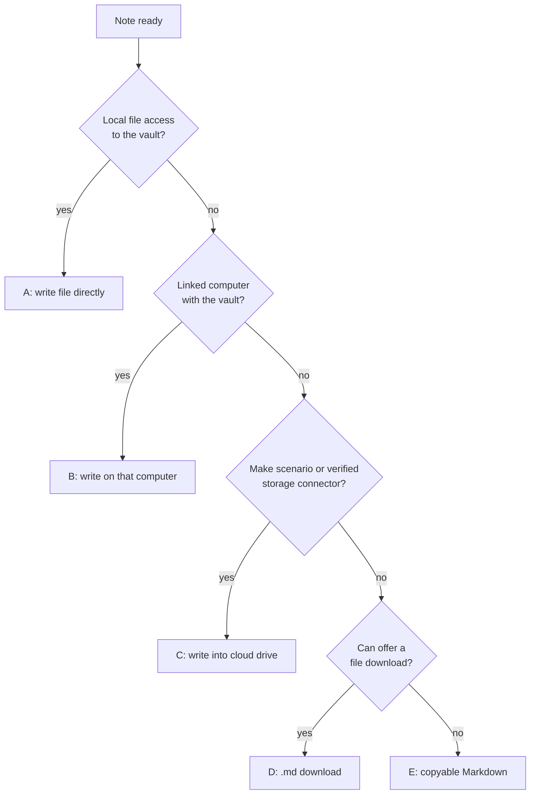

# Save conversation to Obsidian

Use this skill when the user asks to save, log, archive or summarize "this conversation / chat / session" into Obsidian or their vault, for example "save this to Obsidian", "put a summary of this chat in my vault", "/save-conversation-to-obsidian".

This skill is **model-agnostic**. Claude, ChatGPT, Gemini, a coding agent or any other assistant may run it. Tool names below are examples; use whatever file, shell, connector and search tools your environment actually has.

The job has two parts that must never block each other:

1. **Write a good note** (Steps 3–4). This always succeeds.
2. **Get it into the vault** (Steps 1 and 5). Try the best available route; the last route (copyable Markdown) always works.

---

## Step 0: Load the configuration

The skill ships without any personal settings. Look for the user's configuration in this order and use the first complete one:

1. The **Configuration** block at the end of this file, if its values are filled in.
2. The assistant's **persistent memory, custom instructions or project knowledge**. Look for an entry named `obsidian-conversation-config`.
3. A **config note in the vault** named `save-conversation-config.md` in the vault root (readable only on routes with vault access, see Step 1).

If a configuration is found, use it silently. Don't re-ask anything it answers. If a single value you need is missing, ask only for that value.

If no configuration exists, run the **first-run setup** below before doing anything else, then continue with Step 1 in the same turn.

### First-run setup

Tell the user in one or two sentences what the skill does and that a few one-time questions follow (about two minutes). Then ask in **at most three rounds**. Group questions, offer sensible defaults, and use multiple-choice question widgets if your interface has them. Infer what you can (timezone, language, device) and ask the user only to confirm.

**Round 1: vault and sync (required)**

- What is the vault called, and on which devices do you use it? For each device, where is the vault folder? Desktop example: `C:\Users\me\Obsidian\MyVault` or `~/Documents/MyVault`. On Android the path is often `/storage/emulated/0/Documents/<Vault>`; on iOS it's usually in iCloud Drive › Obsidian. "I don't know" is an acceptable answer for mobile.
- How do you sync the vault between devices? OneDrive, Google Drive, Dropbox, iCloud, Obsidian Sync, Syncthing, Git, or not synced. For OneDrive, Google Drive and Dropbox, ask where the vault folder is inside that drive (for example `/Obsidian/MyVault`).

**Round 2: where notes go**

- Default: one folder for all conversation notes, `Conversations/` in the vault root. Offer to change it.
- Optional **project routing**: if the user keeps one folder per project (e.g. `Projects/<Name>/`), ask for that parent folder and the name of the subfolder for conversations (default `Conversations`). Notes from a chat that belongs to a project (Claude Project, ChatGPT Project, Gemini Gem, a repo) then go to `<projects parent>/<Project>/<subfolder>/`. Everything else goes to the default folder.

**Round 3: optional features** (offer the defaults in one question)

- Session usage/cost estimate section: on (default) or off.
- Mermaid diagrams where they help: on (default) or off.
- Extra tags to always add: none by default.

**Write route.** Check which routes from Step 1 work right now and tell the user in plain words which one will be used. If the user works on a phone and no route better than download is available, explain the Make option once (see Step 1, route C):
> "On phones, AI apps can't write into your vault folder directly. If your vault syncs through OneDrive, Google Drive or Dropbox, a free Make.com account plus the Make connector in this app lets me save notes straight into it. Want me to walk you through the setup (about 15 minutes)? Otherwise I'll give you a download or copyable Markdown each time."

If they say yes, read `references/make-setup.md` and guide them step by step with it. If they decline, record `make.declined: true` and don't offer again.

**Save the configuration.** Show the finished YAML (every field is explained in `references/config-schema.md`) and store it everywhere that is available, telling the user where:

- In the assistant's persistent memory under `obsidian-conversation-config`, if the assistant has memory and the user agrees. Keep it compact.
- As `save-conversation-config.md` in the vault root, if a write route works (put the YAML inside a fenced `yaml` block).
- On platforms where skills are files the user uploads, offer an updated copy of this skill with the Configuration block filled in.

Never store passwords, tokens or API keys. The configuration holds only names, paths and switches; Make connections authenticate through their own login.

---

## Step 1: Choose a write route

Use the first route that works. Don't retry a route that failed more than once; move on and tell the user which route was used in the end.



**A. Local file access.** The assistant runs on the device that holds the vault and can read and write files there: coding agents (Claude Code, Codex CLI, Gemini CLI and similar), desktop apps with folder access, an agent running in Termux on Android. Write under that device's `vault_roots` entry.

**B. Linked computer.** The assistant runs elsewhere but has a bridge to a computer that holds the vault, for example a Claude session linked to the desktop app, or a filesystem MCP server. Find the vault on that computer (a connected folder or `vault_roots`), write there, and let the vault's sync carry the note to the other devices. If the computer can't be reached (asleep, app closed), move on to route C.

**C. Cloud drive.** For vaults synced through OneDrive, Google Drive or Dropbox. Write into `sync.cloud_path`, and the drive's sync delivers the note to every device.

- **Make scenario (preferred).** If `make.enabled` is true and a Make tool is available, call the scenario named in `make.scenario`. If you can't see it, look through the available tools or Make's scenario list for "obsidian", "vault" or "api shell". Two interface variants exist, listed in `make.variant`:
  - `vault-bridge` (inputs `action`, `folder`, `filename`, `content`; outputs `status`, `name`, `items`, `message`):
    - List subfolders: `action: "list"`, `folder: "<vault-relative folder>"`. The result is folder names in `items`.
    - Write a note: `action: "write"`, `folder`, `filename`, `content`. `status` is `ok` (with the created `name`), `exists` (pick the next free name, see Step 5, and retry) or `error` (read `message`).
    - Folder paths are relative to the vault root, use forward slashes and have no leading slash. The scenario adds `sync.cloud_path` itself.
  - `onedrive-api-shell` (inputs `path`, `method`, `header`, `qs`, `body`; output `data`; forwards Microsoft Graph calls):
    - List: `GET /v1.0/me/drive/root:<cloud_path>/<folder>:/children` with `qs` `$select=name,folder`.
    - Write: `PUT /v1.0/me/drive/root:<cloud_path>/<folder>/<filename>:/content`, header `Content-Type: text/markdown; charset=utf-8`, `qs` `@microsoft.graph.conflictBehavior=fail`, body = the note text. A 409 conflict means the name is taken.
    - Graph creates missing parent folders on upload.
    - **Don't pre-encode spaces as `%20`.** Pass the filename with normal spaces. Always check the returned item `name`. If it contains a literal `%20`, rename it right away: `PATCH /v1.0/me/drive/items/<id>` with body `{"name":"<correct name>"}`. If Graph reports an empty JSON payload, pass the PATCH body as a JSON **string** instead of an object.
- **Native storage connector.** Use one only if the user confirmed earlier that it works (`sync.connector_verified: true`). It must create a plain `.md` file with the exact name in the exact folder, not a converted Google Doc or Word file. Check the result after writing.
- How the two scenario variants are built is described in `references/make-setup.md`; read it only when setting up or debugging a scenario.
- If the Make tool is missing but `make.enabled` is true, tell the user the Make connector isn't enabled in this chat, then continue with route D.

**D. Download.** If the assistant can hand the user a file, create `<filename>.md` with the full note and give the exact target path for the user's current device, e.g. `/storage/emulated/0/Documents/MyVault/Conversations/2026-09-27 Topic.md`. Skip live checks this route can't do (folder listing, tag search, vault links) and say so. Use `folders.known_projects` for routing.

**E. Copyable Markdown (always works).** Output the whole note in one fenced block that opens with **four** backticks plus `markdown` and closes with four backticks, so the three-backtick code fences inside the note survive. Above it, name the target folder and filename. On a phone, add one line: "Copy the block, create a new note with this name in Obsidian, paste."

After a download or copy (D or E), and if a better route could be set up but `make.declined` isn't true, mention the Make option in one sentence, at most once per conversation.

---

## Step 2: Choose the destination folder

1. If `folders.projects_root` is empty, use `folders.default` and go to Step 3.
2. **Find the project name**: the project or workspace the conversation lives in (Claude Project, ChatGPT Project, Gemini Gem, the repo or working folder of a coding agent). If there is none, use `folders.default`.
3. **List the project folders** inside `folders.projects_root`, live if the route allows it (A, B, or C with a list action). Otherwise use `folders.known_projects`. If a live listing differs from `known_projects`, update the stored configuration where you can and mention it.
4. **Match** case-insensitively after removing spaces, hyphens, underscores and punctuation:
   - An exact normalized match wins.
   - Otherwise a folder name contained in the project name (or the reverse) counts, e.g. project "SketchAlchemy Plugin" → folder `SketchAlchemy`.
   - Several candidates: ask the user.
   - A project the user names explicitly ("save it to Subwise") overrides the match.
5. **Destination**: match → `<projects_root>/<Folder>/<folders.project_subfolder>/`; otherwise → `folders.default`. Create missing folders if the route allows it.

---

## Step 3: Gather metadata

### Assistant tag and model
- Tag by the assistant the conversation happened in, lowercase plus `-conversation`:
  - Anthropic Claude (any model) → `claude-conversation`
  - OpenAI ChatGPT / GPT / o-series → `chatgpt-conversation`
  - Google Gemini → `gemini-conversation`
  - Microsoft Copilot → `copilot-conversation`; Mistral Le Chat → `mistral-conversation`; Perplexity → `perplexity-conversation`; DeepSeek → `deepseek-conversation`
  - Anything else → `<product>-conversation`
- Record the exact model identifier if you know it (e.g. `claude-opus-5-5`, `gpt-5`). If unsure, write `unknown`; don't guess.

### Date and time
Use the current local time in `timezone` (or the user's timezone from context). Use a clock tool if one exists.

### Project tag
- Only when a project folder matched. Candidate tag: the folder name lowercased, spaces → hyphens (`My Project` → `my-project`).
- Add it **only if the tag already exists in the vault**, so no near-duplicate tags appear. With shell access, check like this:
  ```bash
  grep -rliE "(#<tag>\b|^\s*-\s*<tag>\s*$|tags:.*\b<tag>\b)" --include="*.md" "<vault>" | head -3
  ```
  Use the spelling found in the vault. Without that kind of access, leave the project tag out.
- Add any `note.extra_tags`.

### Git commits
- If the conversation created commits, collect short SHA, full SHA, subject, repository, branch and whether each was pushed.
- Link format: `https://github.com/<owner>/<repo>/commit/<sha>` (GitLab: `/-/commit/`). Unpushed commits get no link and the status `local`.

### Usage and cost estimate (if `note.usage` is on)
- Prefer real figures if the environment reports them (a `/cost` command, a usage panel, API usage data).
- Otherwise estimate:
  - Tokens ≈ characters ÷ 4 for all text in the context, including tool results and files read.
  - Input tokens add up per model call, because every call re-sends the whole context. Output ≈ everything the assistant generated.
  - Prompt caching, when it applies, makes real cost much lower; say so.
- Cost = tokens × the model's current API price per million tokens. Look the price up on the vendor's pricing page if you have web access and cite it. Otherwise give tokens only and write the cost as `unknown`.
- On a subscription plan, label the cost "API-equivalent".
- Round and mark as estimates (e.g. ~180k tokens, ~$2.40).

---

## Step 4: Write the note

Summarize the **whole** conversation, not just the last turns, in the language most of it was held in. Be concrete: files, tools, numbers, decisions. Leave out chit-chat and dead ends, unless a dead end is worth remembering ("tried X, failed because Y").

### Formatting rules
- One `#` H1 (the topic). Main sections are `##`, subsections `###` (`####` only if really needed). Don't skip levels.
- Anything someone might copy (commands, code, config, paths) goes in a fenced code block with a language tag. Put one command per block when they're used on their own.
- Omit every empty section except **Summary**.
- Vault links (`[[...]]`) only to notes confirmed to exist. Never invent links or URLs.
- Readable in one to two minutes; details go in the lower sections.

### Diagrams (if `note.diagrams` is on)
Where a picture explains something better than prose, add a Mermaid diagram **next to the text it illustrates**. The text must still carry the essential information on its own.

| Content | Diagram type |
| --- | --- |
| Workflow, pipeline, process steps | `flowchart LR` / `flowchart TD` |
| Decision tree, routing rules, if/else logic | `flowchart TD` with `{decision}` diamonds and labelled edges |
| Structure, components, folder or dependency relations | `flowchart` with `subgraph`s, `classDiagram` or `erDiagram` |
| Interaction between systems over time | `sequenceDiagram` |
| States and transitions | `stateDiagram-v2` |
| Schedule or phases | `gantt` or `timeline` |

Skip diagrams for trivial or two-step content. Usually 0–3 per note, each at most ~15 nodes.

Rendering rules for Obsidian:

- Use a fenced `mermaid` block.
- Use only the diagram types above; experimental types (e.g. `architecture-beta`) may not render.
- Quote labels with special characters: `A["Download (.md)"]`. Use `<br>` for line breaks.
- Use short ASCII node IDs, and never `end` as an ID.
- No `%%{init}%%` theme overrides.
- Check that every `subgraph` has an `end`.

### Template

````markdown
---
title: <Topic>
date: YYYY-MM-DDTHH:mm
type: conversation-summary
assistant: <Claude | ChatGPT | Gemini | ...>
model: <model id or unknown>
source-project: <project/workspace name, or "none">
tokens-estimate: <e.g. ~180k>          # only if note.usage
cost-estimate: <e.g. ~$2.40 (API-equivalent) | unknown>   # only if note.usage
tags:
  - <assistant>-conversation
  - <project tag, only if it exists in the vault>
  - <0-2 topical tags, lowercase-kebab>
---

# <Topic>

## Summary
<One paragraph (4-8 sentences): the goal, what was done, how it ended, and what is still open.>

## Key decisions
- **<Decision>** — <short reason>

## Action items
- [ ] <next step>

## Workflow
<One or two sentences, plus a diagram if it helps.>

## Commands
### <Purpose>
```bash
<command>
```

## Code & configuration
### <What it is>
```<language>
<snippet that was the actual result>
```

## Files
### Created
- `<path>` — <what it is>
### Modified
- `<path>` — <what changed>

## Commits
| Commit | Message | Repo / branch | Status |
| --- | --- | --- | --- |
| [`abc1234`](https://github.com/owner/repo/commit/<sha>) | <subject> | owner/repo · main | pushed |

## Links
### Vault notes
- [[<existing note>]] — <why relevant>
### External
- [<Title>](<url>) — <why relevant>

## Session usage
| Metric | Value |
| --- | --- |
| Model | <model> |
| Input tokens (est.) | <~n> |
| Output tokens (est.) | <~n> |
| Cost (est.) | <~$n, API-equivalent / unknown> |
| Basis | <usage report or chars÷4 heuristic; pricing source and date> |
````

---

## Step 5: Save the note

- **Filename**: `YYYY-MM-DD <Topic>.md` (topic of 3–6 words, title case) unless `note.filename` says otherwise. Remove characters that Windows, macOS, Android or Obsidian reject: `\ / : * ? " < > | # ^ [ ]`.
- **Never overwrite.** If the name is taken, append ` 2`, ` 3`, and so on.
- With a shell, write through a quoted heredoc so nothing gets expanded (pick another delimiter if the note contains a line `EOF`):
  ```bash
  mkdir -p "<vault>/<dest>" && cat > "<vault>/<dest>/<file>.md" <<'EOF'
  ...note...
  EOF
  ```
- **Verify**: read the first ~20 lines back, or check the name returned by the cloud API.

## Step 6: Report back

Reply in one or two lines: the vault-relative path, the route used (local, linked computer, Make/cloud drive, download or copy), whether it went to a project folder or the default folder, and the usage estimate if enabled. If it landed in the default folder because no project matched, add that the user can move it or name the project next time.

---

## Configuration

Fill in the values, or let the assistant fill them in during first-run setup. Empty values mean "not set". Every field is explained in `references/config-schema.md`.

```yaml
obsidian-conversation-config:
  vault_name: ""
  timezone: ""
  vault_roots:
    windows: ""
    macos: ""
    linux: ""
    android: ""
    ios: ""
  sync:
    method: ""                 # onedrive | google-drive | dropbox | icloud | obsidian-sync | syncthing | git | none
    cloud_path: ""
    connector_verified: false
  make:
    enabled: false
    declined: false
    scenario: ""
    variant: ""                # vault-bridge | onedrive-api-shell
  folders:
    default: "Conversations"
    projects_root: ""
    project_subfolder: "Conversations"
    known_projects: []
  note:
    filename: "YYYY-MM-DD {Topic}.md"
    usage: true
    diagrams: true
    extra_tags: []
```
