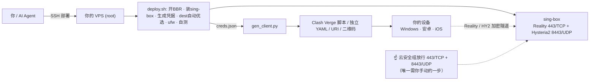

# personal-vpn-deployer

[](https://github.com/IronHuang/personal-vpn-deployer/actions/workflows/ci.yml)
[](LICENSE)


> 一个 **Claude / AI Agent Skill**：让 AI 帮你在**自己的服务器**上一键部署个人自用的
> sing-box 双协议翻墙节点（**VLESS-Reality + Hysteria2**），并自动生成 Clash Verge /
> Clash Meta / Shadowrocket 客户端配置。

你只需要提供**服务器地址**和**一种 SSH 登录方式**（密码 / 私钥文件 / 已配免密），
支持该 skill 的 AI Agent 就能替你完成：装 sing-box、生成凭据、优选伪装目标、配防火墙、
启动自测、产出所有客户端配置。

> ⚠️ **仅限个人自用与学习**，且必须是**你自己拥有、有权操作**的服务器（VPS/云主机）。
> 请遵守你所在地区的法律法规。本项目不用于协助未授权访问他人系统。

---

## ✨ 特性

- **双协议互补**
  - **VLESS-Reality（TCP/443）**：主力。速度快，借用大站 TLS 伪装，**无需自备域名/证书**。
  - **Hysteria2（UDP + salamander 混淆）**：兜底。抗 TCP 干扰，Reality 被墙时自动接管。
- **伪装目标（dest）自动优选**：实测候选站点，选出从**你这台服务器**访问正常的目标
  —— 这是 Reality 稳定的关键（换 IP/机房后原 dest 常失效，见排障手册）。
- **一条命令产出全部客户端配置**：Clash Verge 注入脚本、独立 YAML、分享链接、二维码。
- **沉淀了真实运维经验**：换 IP 迁移、Reality 握手失败、HY2 限速、GFW 干扰……
  `references/troubleshooting.md` 按真实故障频率排序，每条都有判定命令与修复。
- **Agent 友好**：`SKILL.md` 是执行入口，脚本可直接被调用，无需人肉拼命令。

---

## 🗺 架构与流程



> **两个协议互补**：Reality（TCP）主力、快；Hysteria2（UDP + 混淆）兜底、抗 TCP 干扰。
> 客户端 `🏠 自建` fallback 分组优先走 Reality，断了自动切 HY2。

---

## 🚀 用法一：让 AI Agent 用这个 Skill（推荐）

### 安装 Skill

把本仓库放到你的 Agent 能读取 skill 的目录。以 Claude Code 为例：

```bash
git clone https://github.com/<your-name>/personal-vpn-deployer.git
# 放到 skills 目录（路径以你的客户端为准），或直接在仓库目录里对 Agent 说：
```

### 对 Agent 说

> “用 personal-vpn-deployer 在我的服务器上部署 VPN。服务器 `1.2.3.4`，我已经配好 root 免密。”

或提供其它登录方式：

> “……服务器 `1.2.3.4`，root 密码是 xxx（请先帮我配免密）。”
> “……私钥在 `~/.ssh/id_ed25519`。”

Agent 会按 `SKILL.md` 的五步流程走完，并在最后提醒你去**云安全组放行端口**（这一步只能你自己点）。

---

## 🔧 用法二：手动部署（不借助 Agent）

### 0. 前置

- 一台海外 VPS（Ubuntu 20.04/22.04+，x86_64，≥1GB 内存），root 权限。
- 本地装了 `git`、`ssh`、`python3`。

### 1. 配置 SSH 免密（推荐）

**Linux / macOS：**
```bash
ssh-keygen -t ed25519 -C "vpn-deploy"     # 已有密钥可跳过
ssh-copy-id root@<服务器IP>                # 输一次服务器密码
ssh root@<服务器IP> "echo OK"             # 验证：不再要密码
```

**Windows（PowerShell）：**
```powershell
ssh-keygen -t ed25519 -C "vpn-deploy"
type $env:USERPROFILE\.ssh\id_ed25519.pub | ssh root@<服务器IP> "mkdir -p ~/.ssh && chmod 700 ~/.ssh && cat >> ~/.ssh/authorized_keys && chmod 600 ~/.ssh/authorized_keys"
ssh root@<服务器IP> "echo OK"
```
更多细节与排查见 [`references/passwordless-ssh.md`](references/passwordless-ssh.md)。

### 2. 服务端一键部署

```bash
scp scripts/deploy.sh root@<服务器IP>:/tmp/deploy.sh
ssh root@<服务器IP> "REALITY_PORT=443 HY2_PORT=8443 bash /tmp/deploy.sh"
```

脚本会自动完成：开 BBR → 装 sing-box → 生成密钥/UUID/密码/自签证书 → **优选 Reality dest**
→ 写 `/etc/sing-box/config.json` → 配 ufw → 启动 → 本机自测 → 打印凭据。

把输出中 `===VPN_CREDS_BEGIN===` 与 `===VPN_CREDS_END===` 之间的 JSON 存成本地
`creds.json`（服务器上也存了一份 `/etc/sing-box/creds.json`，`chmod 600`）。

### 3. 云安全组放行（**必做**）

在云厂商控制台放行**入站**：`TCP 443`、`UDP 8443`（HY2 是 **UDP**，别放成 TCP！）。
各家路径见 [`references/cloud-security-group.md`](references/cloud-security-group.md)。

### 4. 生成客户端配置

```bash
python scripts/gen_client.py --server <服务器IP> --creds creds.json --outdir client-configs
```

产出到 `client-configs/`：
| 文件 | 用途 |
|---|---|
| `clash-verge-inject.js` | Clash Verge **Script 覆写**，注入现有订阅（订阅更新不丢），**有订阅首选** |
| `clash-standalone.yaml` | 独立 Clash/mihomo 配置（Clash Meta / 无订阅用户） |
| `nodes.txt` | `vless://` / `hysteria2://` 分享链接（Shadowrocket 粘贴） |
| `qrcodes.txt` | 两个节点的二维码图片链接（手机扫码） |

各客户端导入步骤见 [`references/clients.md`](references/clients.md)。

### 5. 验证

客户端选中 Reality 节点，访问 `https://api.ipify.org`，出口 IP 应等于服务器 IP。
体检脚本：`scp scripts/diagnose.sh root@<host>:/tmp/ && ssh root@<host> "bash /tmp/diagnose.sh"`。

---

## 🛠 出问题了？

`references/troubleshooting.md` 按真实故障频率排序，摘要：

| 症状 | 头号原因 | 一句话修复 |
|---|---|---|
| Reality 突然 timeout（尤其换 IP/机房后） | dest 从本服务器 TLS 后卡死 | 重选 dest，改服务端 `server_name`+`handshake.server` 与客户端 `servername` |
| Reality 偶发断线、延时 Error | IP 被 GFW 盯上、间歇干扰握手 | 换公网 IP / 套 Cloudflare CDN；**别换端口** |
| HY2 一直 timeout | 安全组只放了 TCP | 放行 **UDP** 端口 |
| HY2 慢（视频卡） | 国内 UDP QoS 限速 | 保留 Brutal `up/down`、端口跳跃；大带宽走 Reality |
| claude.ai / GitHub 用自建 IP 不通/慢 | 机房 IP 被目的站风控 / 国际线路慢 | 这些域名分流到干净节点 |

> **反直觉但重要**：Reality 请**永远待在 443**。换高位端口会撕掉它的 HTTPS 伪装、反而更易被识破。

---

## 📁 仓库结构

```
personal-vpn-deployer/
├── SKILL.md                    # Agent 执行入口（五步流程）
├── README.md                   # 本文件
├── LICENSE
├── scripts/
│   ├── deploy.sh               # 服务端一键部署（含 dest 自动优选、本机自测）
│   ├── gen_client.py           # 客户端配置生成器（Verge 脚本 / YAML / URI / 二维码）
│   └── diagnose.sh             # 服务端诊断体检
└── references/
    ├── troubleshooting.md      # 排障手册（真实运维经验，按频率排序）
    ├── clients.md              # 各客户端导入指南
    ├── passwordless-ssh.md     # 免密 SSH 教程（Win / Linux / Mac）
    └── cloud-security-group.md # 云安全组放行（腾讯云 / 阿里云 / AWS）
```

---

## 🔒 安全提醒

- 生成的客户端配置与 URI **含明文凭据**（private key 对应公钥、UUID、密码等），
  **别发到公开渠道**（论坛、截图、公开仓库）。请离线备份到密码管理器。
- 换 VPS 前务必留存凭据，否则客户端要全部重配。
- 若临时在服务器上托管订阅文件供手机拉取，用**高位端口 + 随机 token**，**用完即关**，
  别长期明文暴露。

---

## 📜 License

MIT，见 [LICENSE](LICENSE)。本项目按现状提供，使用者自行承担合规与风险责任。
