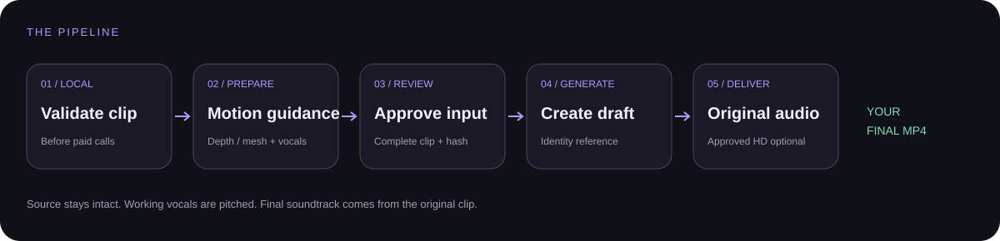

# Genjutsu Skill

[](https://github.com/SaeedAngiz1/Genjutsu-Skill/actions/workflows/checks.yml)
[](LICENSE)
[](https://github.com/SaeedAngiz1/Genjutsu-Skill/releases/latest)

**Turn one video request into a complete AI character replacement workflow.**

Give Claude Code or Codex your clip, character reference, creative direction and budget. Genjutsu guides the agent through preparation, visual review, a paid draft, recovery and final export with the original soundtrack.


MIT · Claude Code + Codex · Python · macOS / Linux / WSL2

## The idea

Your source supplies the performance. Your reference supplies the identity. The agent manages the workflow.

- **Three preparation modes:** depth masking, face mesh, or both.
- **Image and video references:** image identity routes to Edit; video identity routes to Omni.
- **Draft first:** inspect the result before an authorized HD upgrade.
- **Original audio:** working vocals get a temporary +3 semitone pitch shift; the final export restores the source soundtrack.
- **Recovery that respects spending:** persisted state helps collect existing jobs after interruptions.
- **Review tied to artifacts:** preparation changes invalidate the earlier review.

One request can cover the whole job. It still needs working accounts, a usable source, actual visual inspection and authorization for the paid operations.



## Install the skill

Download the [v0.1.0 skill ZIP](https://github.com/SaeedAngiz1/Genjutsu-Skill/releases/download/v0.1.0/genjutsu-skill-v0.1.0.zip), extract it, and open a terminal in its root. The repository root is the skill package. You can also clone [this repository](https://github.com/SaeedAngiz1/Genjutsu-Skill).

```bash
python3 scripts/install.py
```

On Windows PowerShell:

```powershell
py scripts/install.py
```

The default destination is `~/.claude/skills/genjutsu-video-workflow`. Restart Claude Code or start a new session, then invoke `/genjutsu-video-workflow`.

For Codex:

```bash
python3 scripts/install.py --agent codex
```

For a custom destination, quote the path:

```powershell
py scripts/install.py --target "C:\my skills\genjutsu-video-workflow"
```

A custom folder needs to be inside your agent's skill discovery location to be discovered automatically. The installer will report its result; it does not silently overwrite an existing installation.

## Set up the video runtime

The installer copies the skill. The bundled runtime needs **Python 3.12+, Rubber Band, cloudflared or a public callback, and your own Replicate and Enhancor accounts**. Default inference uses cloud services and does not require a local GPU. Open-source code does not make inference free.

From the installed Claude skill on macOS, Linux or WSL2:

```bash
cd "$HOME/.claude/skills/genjutsu-video-workflow/assets/workflow"
bash setup.sh
```

For face mesh and combined mode, install Python 3.12 specifically and run:

```bash
cd "$HOME/.claude/skills/genjutsu-video-workflow/assets/workflow"
bash setup-face-mesh.sh
```

Enter your own keys in the runtime's `.env`, then launch:

```bash
cd "$HOME/.claude/skills/genjutsu-video-workflow/assets/workflow"
bash start.command
```

Use the localhost URL printed by the launcher. Keep the server and callback running during remote jobs. For Codex or a custom install, use its reported installation path in place of the Claude path above.

**Windows:** the Python installer runs in PowerShell; the video runtime uses WSL2. Install the skill from the same environment where your agent runs. If Claude Code runs inside WSL, install from WSL so its Linux home is the discovery destination.

The detailed setup guide is [the runtime runbook](assets/workflow/docs/SETUP-AGENT.md).

## Make one complete request

Invoke `/genjutsu-video-workflow` in Claude Code or `$genjutsu-video-workflow` in Codex, then provide a request like this:

> Replace the speaker in `/home/me/clips/interview.mp4` with the character in `/home/me/references/character.png`. Preserve the performance, timing and complete original soundtrack. Use face mesh if tracking is suitable; otherwise explain the required mode change. Prompt: cinematic live-action character, natural lighting, stable identity, no visible guide lines. Save the final video to `/home/me/exports/interview-final.mp4`. I authorize one prepared run and one paid draft, up to US$10 total; stop if the cost cannot be established within that limit. Do not upgrade to HD until I approve the draft. Inspect the full prepared clip and finished draft, and report the result and remaining issues.

Use absolute paths to your own files. Identify each subject when there is more than one; ambiguous mappings need clarification. An identity video must remain a video reference.

The agent uses the bundled command wrapper for `doctor`, `preflight`, `prepare`, `review`, `submit`, `status`, `resume` and `hd`. It reads mode-specific guidance as needed instead of loading the entire runtime manual.

## Pick the right mode

| Mode | Use it for | What must be reviewed |
| --- | --- | --- |
| `depth` | Subject replacement requiring depth and segmentation guidance | Full-clip mask coverage, edges and spill |
| `face_mesh` | A single centered speaker with trackable facial motion | Full-clip tracking, alignment and audio |
| `depth_mesh` | Depth masking plus facial motion guidance | Both mask coverage and facial tracking |

Face mesh is experimental and optimized for one centered speaker. A contact sheet or passing file checks cannot establish full-clip visual quality.

## What's included

`SKILL.md` is the agent entrypoint. `scripts/` contains installation and runtime helpers. `references/` contains task guidance. `assets/workflow/` contains the adapted MIT-licensed Python runtime. `tests/` and [the validation report](docs/VALIDATION.md) describe reproducible checks and their limits.

Tutorial footage, example videos, private runs, credentials and upstream branded artwork are excluded. Supply your own source clips and identity references.

## Reliability and limits

This package adds orchestration and recovery checks around a generative workflow. Actual provider access, spending, visual quality and agent behavior need their own acceptance tests; offline tests do not prove those outcomes. See [VALIDATION.md](docs/VALIDATION.md) for the results achieved for this release.

Model output can still drift, masks can spill and tracking can fail. The useful promise is a reviewable workflow with explicit state and actionable failures. No skill can guarantee flawless model output or viral reach.

## Credit and license

Based on [Sirio Berati's Genjustsu Open Source Workflow](https://github.com/sirioberati/Genjustsu-Open-Source-Workflow) and [the accompanying tutorial](https://youtu.be/d6spCMcfkew). This repository packages and adapts that workflow for coding agents; it is an independent project.

Distributed under [MIT](LICENSE). Upstream copyright and license notices are retained in the bundled runtime. Service use remains subject to each provider's terms and pricing.

For sharing the project, use [the prepared launch copy](docs/LAUNCH-COPY.md) and add a real demo after testing with your own media.
