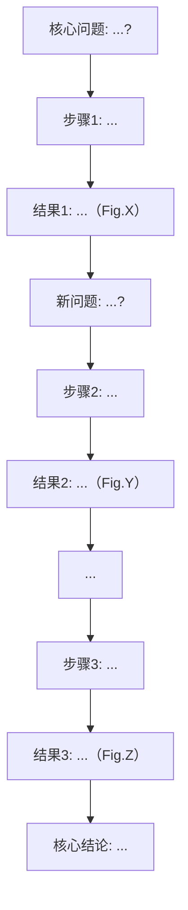

# Results Narrative Module

Deep-read Dimension 2.5「实验结果叙事线」的完整模板。放在证据链（dim 2）和方法严谨性（dim 3）之间。

## 目标

让读者能独立复述这篇论文的实验故事——做了什么实验、为什么按这个顺序做、每一步得到了什么、结果如何导向下一步。

## 输出模板

```markdown
## 2.5 实验结果叙事线

### 故事弧线

[≤200字。一段完整的叙事弧线：从核心科学问题出发，经过关键实验发现了什么，最终得出什么结论。
不是"先做A再做B"的流水账，而是对"这篇论文讲了一个什么科学故事"的叙事提炼。

示例："作者从XXX临床现象出发，假设YYY是关键调控因子。为验证这一假设，他们先用转录组学筛选出候选基因（Fig.1），再通过基因敲除和回补实验确认了YYY的表型（Fig.2），随后用ChIP-seq和EMSA证明YYY直接结合靶基因ZZZ的启动子（Fig.3-4），最后在动物模型中验证了该调控轴的病理意义（Fig.5）。"]

### 实验步骤推演

| 步骤 | 科学问题 | 实验设计 | 关键结果 | 作者解读 | 逻辑推进 |
|------|---------|---------|---------|---------|---------|
| 1 | [该步骤试图回答什么科学问题？] | [具体做了什么实验？用了什么体系/条件/菌株？] | [得到了什么数据？] → [Fig.X ref] | [作者如何解释这些结果？] | [这一步的结果如何导向步骤2？] |
| 2 | ... | ... | ... → [Fig.Y ref] | ... | ... |
| ... | ... | ... | ... → [Fig.Z ref] | ... | [最终结论] |

**表格填写指南**：
- 「科学问题」：每步只问一个问题。如果一步实验回答多个问题，拆分为多个步骤。
- 「实验设计」：足够具体。不说"做了酶活测定"，说"以XXX为底物，在pH 7.0、37°C条件下测定粗酶液的XXX活性（Methods p.X）"。
- 「关键结果」：引用具体 Figure panel + 数据方向。"Fig.2B：Δgene 的酶活为 WT 的 12±3%（n=3, p<0.001 vs WT）"。
- 「作者解读」：引用原文中作者的解读，不要插入你自己的评价（评价留给 dim 2 和 dim 3）。
- 「逻辑推进」：解释步骤间的因果关系。"步骤1筛选出候选基因YYY → 步骤2验证YYY是否真的影响表型"。

### 叙事逻辑图



如果 Mermaid 渲染不可用，使用 ASCII 流程图替代：

```
核心问题 → 步骤1(实验) → 结果1(Fig.X)
                              ↓
                         新问题 → 步骤2(实验) → 结果2(Fig.Y)
                                                       ↓
                                                  最终结论
```

### 关键转折点

[识别论文实验叙事中的转折节点——不是每个实验结果都是转折。转折点是叙事方向改变的地方。]

每个转折点回答三个问题：
1. **此前的预期**: 作者原本以为/假设什么？
2. **实际发现**: 实验揭示的出乎意料的结果？
3. **叙事转向**: 这个发现如何改变了后续实验的方向？

格式：

- **转折1** [Fig.X]: 此前预期___，实际发现___，因此作者转向了___。
- **转折2** [Fig.Y]: ...

如果论文是线性验证式结构（假设→验证→确认，没有意外发现改变方向），声明：
"该论文为线性验证式结构——作者提出假设后逐步验证，无显著叙事转折。"

### 可复现性检查清单

基于论文 Methods 部分提供的信息，评估他人实验室能否复现核心结果。

| 资源/信息 | 状态 | 详情 |
|-----------|------|------|
| 菌株/细胞系来源 | ✅ 已提供 / ⚠️ 部分 / ❌ 缺失 / 不适用 | [来源实验室/保藏中心/自行构建的细节] |
| 关键试剂/抗体 | ✅ 已提供 / ⚠️ 部分 / ❌ 缺失 / 不适用 | [货号、供应商、稀释比例] |
| 质粒/引物信息 | ✅ 已提供 / ⚠️ 部分 / ❌ 缺失 / 不适用 | [质粒图谱/Addgene #/引物序列] |
| 关键实验条件 | ✅ 已提供 / ⚠️ 部分 / ❌ 缺失 / 不适用 | [培养基/温度/诱导条件/时间等] |
| 原始数据 | ✅ 已存储 / ⚠️ 声明可获取 / ❌ 未声明 | [GEO/SRA/ProteomeXchange accession] |
| 代码/分析流程 | ✅ 已提供 / ⚠️ 部分 / ❌ 未提供 / 不适用 | [GitHub URL/DOI] |
| 统计方法 | ✅ 已描述 / ⚠️ 部分 / ❌ 未描述 | [检验方法/软件/版本] |

**总体可复现性**: [高 — 他人实验室可直接重复 / 中 — 需要额外信息或沟通 / 低 — 关键细节缺失]
```

## 论文类型适配

### 发现/机制研究型论文
标准模板适用。重点放在"假设→验证→排除替代解释→确认机制"的叙事逻辑。

### 方法/工具型论文
调整「实验步骤推演」为「验证步骤推演」——每个步骤验证方法的一个性能方面（灵敏度、特异性、与金标准的对比、应用案例）。

### 组学/大数据型论文
调整表格为两层：第一层「数据生成与质控」→ 第二层「分析流程与发现」。

### 综述
dim 2.5 标记为 `[not applicable]`——综述没有实验叙事线。
